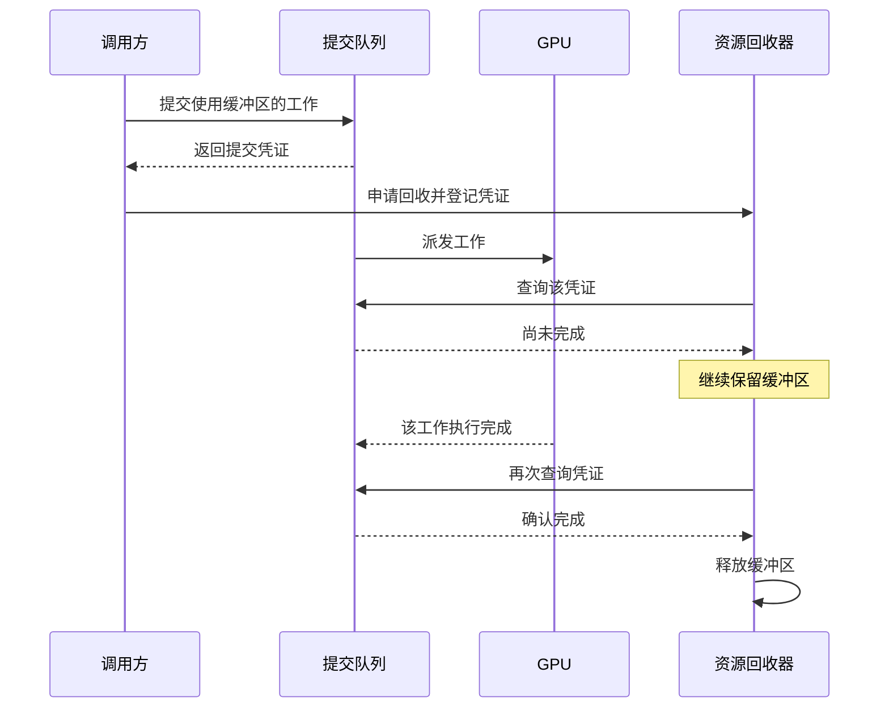
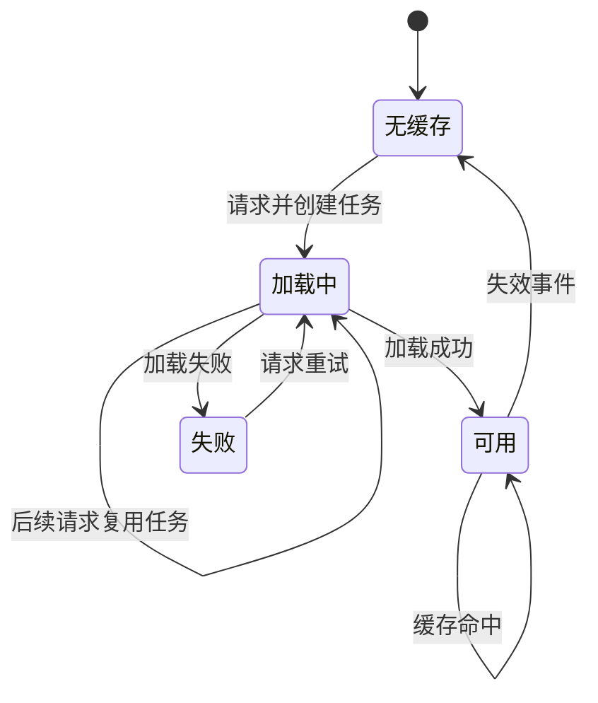
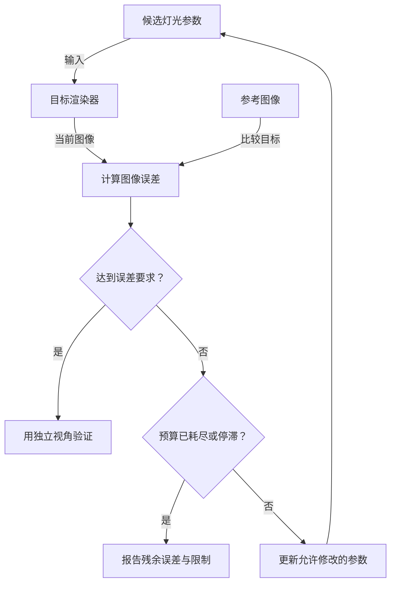
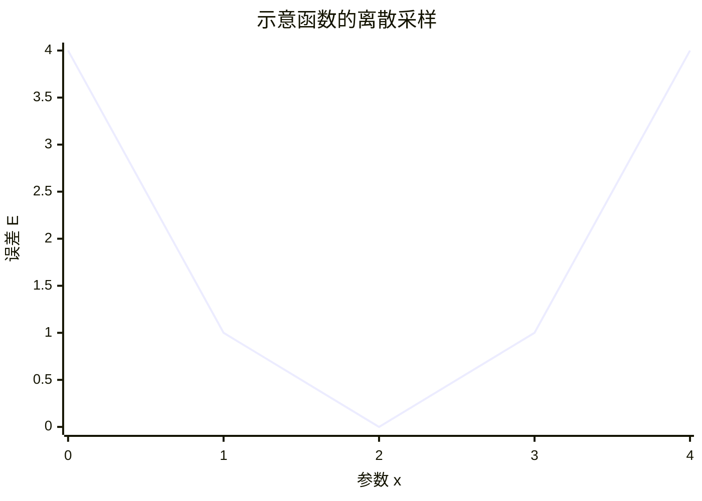

# 技术讲解示例

这些是原创教学模型，用来演示选图与图文配合；不代表某个引擎或代码库的真实实现。使用时换成已核对的项目事实，不照搬模块、线程或性能结论。

## 目录

1. [异步资源为何不能立即释放](#1-异步资源为何不能立即释放)
2. [缓存的状态与失败重试](#2-缓存的状态与失败重试)
3. [参数拟合的反馈原理](#3-参数拟合的反馈原理)
4. [用数值图讲数学关系](#4-用数值图讲数学关系)
5. [方案比较与简单问题](#5-方案比较与简单问题)

## 1. 异步资源为何不能立即释放

**关注时间与使用者，选时序图。** 先用一句话点出：提交返回只说明工作已排队，资源能否释放取决于最后一次使用是否完成。

前提：下面是假设 API 的简化协议，提交时给缓冲区登记一个完成凭证，由回收器查询；不声称是真实 UE API 或线程布局。

图外只补关键推理：调用方不再访问缓冲区，不代表 GPU 不再访问它。图中只画了一次未完成查询，实际可能查询多次。这里释放条件是“该缓冲区所有相关使用都已完成”。生产实现还可能采用引用计数、多个队列的同步等机制，须以代码为准。

如果问题变成“谁拥有这个缓冲区”，改画所有权关系；如果问题是“卡在哪个阶段”，补实际采样的时间数据，而不是把时序图上的竖向距离当作耗时。

## 2. 缓存的状态与失败重试

**关注事件驱动的生命周期，选状态图。** 下图人为定义了一种缓存策略：加载期间复用同一个任务，成功后保留结果，失败后允许显式重试，失效时清空。

图外解释三个不同问题：`Loading` 中复用任务解决重复工作；`Ready` 中复用结果解决重复读取；`Failed` 的重试策略决定恢复行为。真实代码若没有持久缓存、重试或失效逻辑，就删掉对应状态和边。

若需要解释 Promise 如何传播结果或异常，再用短代码或局部时序图补充；不必把同一张状态图改画一遍流程图。

## 3. 参数拟合的反馈原理

**关注输入、误差和更新之间的闭环，选流程图。** 以一个人为定义的灯光参数拟合任务为例，固定相机、场景与曝光，只调整允许修改的参数。

图解释闭环，公式解释优化目标：

\[
\theta^*=\arg\min_{\theta\in\Omega}\sum_{v\in V_{fit}}w_v\,D\bigl(R_v(\theta),I_v\bigr).
\]

在图外定义：`θ` 是允许修改的参数，`Ω` 是参数约束，`v` 是固定视角，`I` 是参考，`D` 是明确选定的图像误差。独立验证视角不参与拟合。根据任务解释为何使用线性或显示空间、怎样对齐曝光，以及选定误差会偏好什么结果。

不能把“更新参数”当作完整算法。用户问算法时，应说明候选更新规则需要什么输入、怎样接受或拒绝候选、何时终止；没有实现信息时提出候选方法并标明假设。改变灯光也不保证能消除材质、阴影或色彩处理差异，因此保留未达标出口。

## 4. 用数值图讲数学关系

**关注数值趋势，选 XY 图。** 下面只演示函数 `E(x)=(x-2)^2` 在整数点的采样。数值由公式计算，不是实测性能，也不是上一节真实渲染误差。

在支持 `xychart-beta` 的宿主中可使用：

解释曲线只需要说明：这个函数在 `x=2` 达到最小值，左右偏离都会增大误差。真实目标是否光滑、是否有多个局部最小值，需另行验证。

如果没有数值，先写定性关系和前提；不要编造曲线。若目标宿主不支持此图型，用同样采样值的两列表格，或已有的标准绘图工具。

## 5. 方案比较与简单问题

“比较三个方案”不自动意味着雷达图。若只有性质和约束，先用精确表格，例如：

| 方案 | 必要条件 | 主要代价 | 验证方式 |
| --- | --- | --- | --- |
| 参数映射 | 两端参数语义可对齐 | 建立与维护映射规则 | 多场景检查映射误差 |
| 黑盒搜索 | 可重复渲染并测量误差 | 多次评估候选参数 | 独立视角与预算内收敛情况 |
| 可微优化 | 存在可用且适当的梯度 | 接入与模型近似成本 | 梯度核对与最终渲染对比 |

这是按明示假设构造的示例，不是对任何项目的已验证推荐。只有当某方案的执行逻辑需要说明时，才给它补图；无评分依据时不画“效果 9 分、成本 6 分”的雷达图。

对于“`x += 1` 是什么意思”，一句话解释足够。对于“异步队列为什么提交后还要等”，时序关系值得画图。选择取决于理解难点，不取决于句子里有没有“代码”二字。
